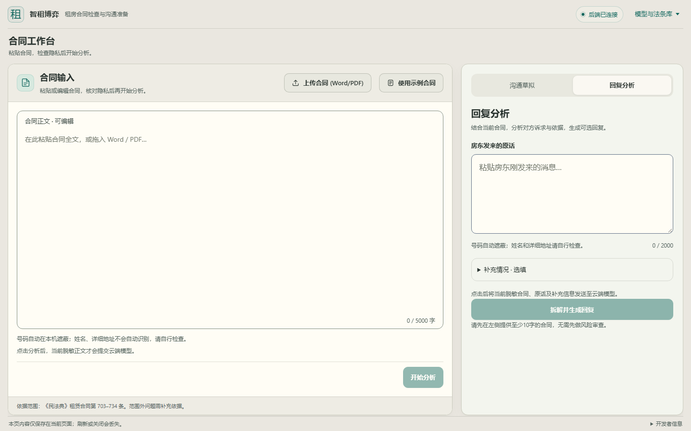

# 智租博弈

智租博弈帮助租客读合同、问条款、回消息。签约前，可以找出值得核对的约定，对照合同原句和相关法条起草给房东的问题。已经收到房东消息时，可以直接粘贴原话，结合手里的合同准备回复。

## 启动前准备

将项目完整解压到本机可写的文件夹。已安装 **64 位 Python 3.12** 的用户可直接进入下一节。首次安装 Python 时，打开命令提示符（CMD）或 PowerShell，运行：

```cmd
winget install --id Python.Python.3.12 --exact --architecture x64 --source winget
```

如果系统提示找不到 `winget`，可从官网下载 Python 3.12 的 **Windows installer (64-bit)**，安装时保留 Python 启动器（py launcher）。第一次启动工作台需要联网下载依赖，体验示例合同可以稍后再配置模型密钥。[Python 3.12 官方安装包](https://www.python.org/downloads/release/python-31210/)

## 双击打开工作台

1. 打开解压后的文件夹，找到与本 README 放在一起的 **启动智租博弈.bat**，双击它。这是每次打开软件的入口。首次运行会弹出命令窗口，自动创建项目环境并安装依赖，请保持窗口打开。
2. 看到「回车直接打开工作台；输入 1 配置模型」时，**直接按回车**即可先体验。手头已有密钥，也可以输入 1，按下节说明一次填好。
3. 浏览器出现 **合同工作台** 就表示启动成功。点「使用示例合同」，即可看到合同正文。若浏览器没有自动打开，将启动窗口显示的「工作台地址」复制到浏览器地址栏。

使用完毕，在启动窗口按 Ctrl+C 退出。下次双击同一个文件即可，脚本会复用已安装的环境。

## 开启 AI 分析

首次启动时可在提示中进入配置；以后要补填或更换密钥，双击 **配置模型服务.bat**。输入密钥时屏幕会隐藏字符，按回车保存。

- **分析房东原话**：菜单选 1，填写 DeepSeek 聊天 Key。
- **检查合同并起草消息**：除聊天 Key 外，菜单再选 2，填写硅基流动向量 Key。Windows 交付包已附默认的 32 条法条索引；从源码仓库运行且缺少索引时，再选 3「法条库维护」准备索引。

配置完成后在菜单按回车退出。首次启动会继续打开浏览器；如果工作台已经在运行，请在原启动窗口按 Ctrl+C，再双击启动脚本，让新配置生效。云端调用使用所配置账户的额度。

## 跟着示例用一次

**想检查合同**，点「使用示例合同」，核对正文后点「开始分析」。从「合同提醒」中选一条，查看它对应的合同原句、解读和法律依据。切到「沟通草拟」，选好条款和沟通方向，写下目标，例如“请房东说明哪些费用可以从押金中扣除”，再点「生成沟通草稿」。

**想回复房东**，载入示例合同后，直接切到「回复分析」。试着输入“押金要等下一个租客入住后才能退”，点「拆解并生成回复」。对照合同核对引用依据，从三档回复中选一条，复制后自行发送。这条路径只使用聊天 Key，可以跳过合同检查。



## 使用自己的合同

支持 DOCX 和文本型 PDF，单个文件最多 10 MiB，PDF 最多 50 页。可提交分析的正文为 10～5000 字符。文件在本机解析；请核对号码是否已遮蔽，并自行隐去姓名和详细地址。点击分析或生成后，脱敏合同及对应输入会发送至云端。刷新或关闭页面前，请复制需要保留的结果。

## 复现与排查

启动脚本按[依赖清单](requirements.txt)准备运行环境，并从[环境变量模板](.env.example)创建本机配置。聊天和向量服务分别使用 CHAT_API_KEY 和 EMBEDDING_API_KEY，交付包索引对应 BAAI/bge-m3。遇到安装失败、密钥未生效或索引缺失时，可查阅[首次使用说明](首次使用说明.md)。

[架构与模块规格](docs/specs/README.md) · [开发对话索引](docs/prompt-history/README.md) · [测试记录](docs/test-results/README.md) · [MIT 许可证](LICENSE)
