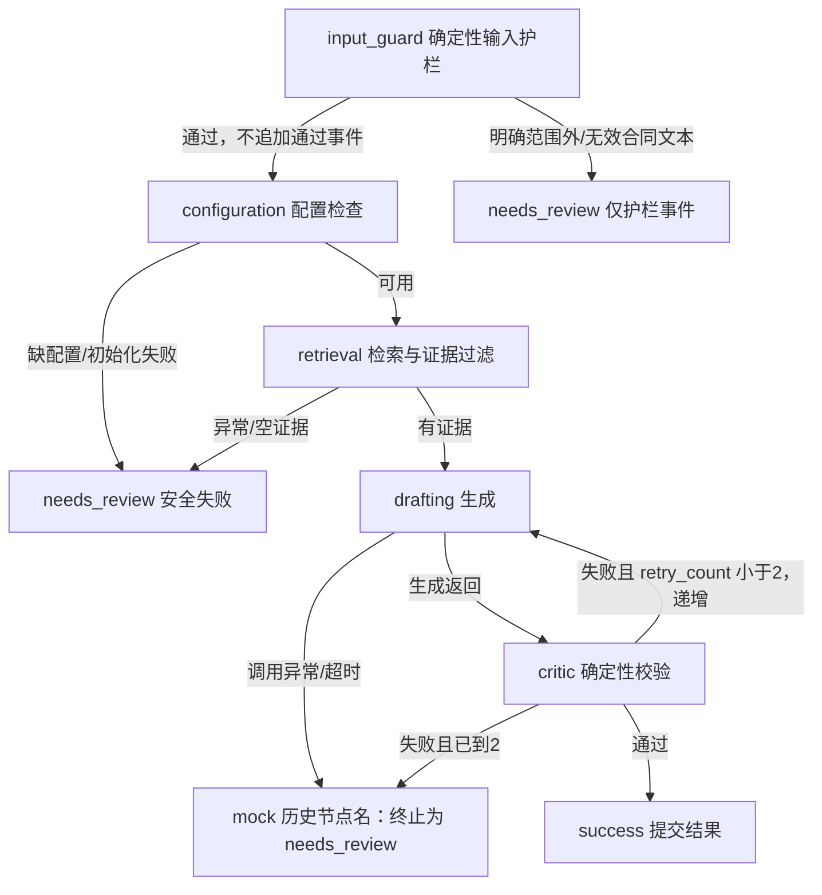

# Spec 02：合同审查、详细失败出口与实际执行 Trace

2026-10-11：开发者正式授权 Day 5 后半段，新增本模块规格并同步 Spec 00。本文不改变法条来源、脱敏定位、最多两次重写和旧接口兼容要求。

2026-10-15 Day 11 增补：开发者授权详细接口的前置输入护栏、对应失败代码与 Trace，以及材料不足判定口径的 Prompt 调整。下文保留 Day 5 历史边界；此增补不填写尚未验证的评测结果。

## 输入与结果

两接口共用 `ReviewRequest`：`contract_text` 为严格字符串，10～5000 字符、不能纯空白；`top_k` 为严格整数，默认4、范围1～8。请求校验失败返回 HTTP 422，不执行检索或图节点。调用云端前遮蔽手机号和身份证号，条款定位以脱敏文本为准。姓名、住址等自由文本仍需调用方人工预览处理。

通过质检的每项结果包含唯一 `C-01` 等 `clause_id`、脱敏合同精确非空子串 `original_clause`、`HIGH/MEDIUM/LOW/NONE` 的 `risk_level`、`explanation`、`evidence_ids` 和 `negotiation_tip`。HIGH 必须有本次检索中的法条 ID；无效或未检索引用被过滤，导致 HIGH 无引用时触发重写。非 NONE 项须有非空解释和建议。计数由 Python 统计非 NONE 项。现有结构、原句、引用和隐私校验继续执行。Day 5 的历史约定为“本轮不调整语义 Prompt”；Day 11 经授权增补下列判定口径。

Day 11 语义 Prompt：仅有材料不足、摘录缺少完整约定或一般性的上下文缺失，不据此推定实质风险，可返回 `NONE` 并说明需要补充材料；文本已经写明的具体不利约定仍需结合实际检索依据判断风险，不因材料不全统一降为 `NONE`。不得把演练标题当作标签，不得把引用存在视为法律实质支持已经通过；真实模型语义评估与离线工程验证分开记录。

## 两个接口

`POST /api/review/analyze` 的 `ReviewResponse` 保持原状：仅 `status=success/mock`、非空 `results`、`total_risks`。缺聊天凭据、初始化/检索/聊天/图异常、空证据、最终校验失败继续返回明确标注的 Mock 演示，HTTP 200。不得给此响应增加 Trace 或错误字段，不改变演示项目与计数。

`POST /api/review/analyze-detailed` 返回 `ReviewDetailedResponse`，已处理的业务成功/失败均 HTTP 200；调用方必须检查 `status`，HTTP 200 不能证明真实审查成功。

| 字段 | 契约 |
| --- | --- |
| `status` | `success` 或 `needs_review`，不出现 `mock` |
| `results` | 成功时非空且全部通过质检；失败时 `[]`，不返回演示或未通过草稿 |
| `total_risks` | Python 计数；失败时0，不代表无风险 |
| `failure_code` | 成功时 null，失败时下表的稳定代码 |
| `reason` | 成功时 null，失败时固定的安全解释，不拼接底层异常 |
| `errors` | 当前终止原因/最终校验反馈的字符串列表，失败时非空；成功时 `[]`。历次失败反馈在 Trace 中保留 |
| `retry_count` | 0～2，仅 Critic 失败且允许重写时递增，不等于 SDK/网络重试次数 |
| `trace_label` | 固定“本次执行回放” |
| `trace` | 按实际完成顺序排列的 `ReviewTraceEvent` 列表，无模拟节点或隐藏思维 |

## Day 11 前置输入护栏（2026-10-15）

仅 `POST /api/review/analyze-detailed` 增加 `input_guard`。原 `ReviewRequest` 字段、类型、长度、空白及 `top_k` 校验不变；后端先遮蔽手机号和身份证号并完成现有有效长度校验，然后执行护栏。护栏须先于配置检查、真实聊天客户端初始化、知识库检索和任何聊天或向量云调用，输入判定只用纯确定性规则，不依赖模型或检索。

上述先后约束针对详细 API 请求路径；服务被 Python 调用方直接构造时的既有初始化生命周期不作变更要求。

- 高置信、明确属于非租赁内容的输入返回 `OUT_OF_SCOPE`。
- 纯程序载荷或无可读合同内容返回 `INVALID_CONTRACT_TEXT`。
- 模糊文本、有效租赁文本和混合载荷中仍有真实租约内容的文本不因该护栏而被拒绝，继续原审查流程；护栏不承担通用语义分类或法律判断。

护栏拒绝是 HTTP 200 的业务失败：`status=needs_review`、`results=[]`、`total_risks=0`、`retry_count=0`，`reason` 与非空 `errors` 来自固定安全文案，`trace_label` 保持“本次执行回放”。`trace` 只包含实际执行的单条 `input_guard` 事件，`sequence=1`、`attempt=0`、`status=needs_review`、`evidence_ids=[]`，耗时实测，反馈受控且不回显输入。不得补造配置、检索、起草、Critic 或终止节点。

护栏通过时不新增通过事件，后续 Trace 保留既有配置检查开始的顺序。未发生检索的护栏拒绝不得返回 `NO_EVIDENCE`；该代码只用于实际检索、过滤后没有可用证据。旧 `/analyze` 的响应格式与兼容回退不变。

## 失败出口

| `failure_code` | 条件 | 是否调用聊天 |
| --- | --- | --- |
| `OUT_OF_SCOPE` | 前置护栏以确定性规则确认高置信明确非租赁内容，仅详细接口 | 否，未配置检查、初始化或检索，不调用云端 |
| `INVALID_CONTRACT_TEXT` | 前置护栏确认纯程序载荷或无可读合同内容，仅详细接口 | 否，未配置检查、初始化或检索，不调用云端 |
| `CHAT_NOT_CONFIGURED` | 无有效聊天密钥 | 否，跳过存储和云端 |
| `CHAT_INIT_FAILED` | 聊天客户端初始化失败 | 否 |
| `KB_NOT_READY` | 缺库、未就绪或库/向量校验错误 | 否 |
| `UPSTREAM_EMBEDDING_ERROR` | 检索时向量服务调用失败 | 否 |
| `RETRIEVAL_FAILED` | 其他检索执行异常 | 否 |
| `NO_EVIDENCE` | 已实际检索并过滤后没有可用证据，不用于前置护栏拒绝 | 否 |
| `CHAT_TIMEOUT` | `TimeoutError`、httpx 超时或 SDK 超时 | 当前生成失败后直接终止 |
| `CHAT_CALL_FAILED` | 其他聊天调用异常 | 当前生成失败后直接终止 |
| `VALIDATION_FAILED` | 第3次生成仍未通过 Critic | 最多3次 |
| `GRAPH_EXECUTION_FAILED` | 图执行发生未预期异常 | 不额外调用，保留已有 Trace |

错误文案只能来自固定错误表和确定性校验反馈；不得回传 HTTP 响应体、原始异常、Pydantic 原始 input、未知模型字段或草稿。结构失败仅展示允许的字段名。运行时错误不依靠字符串匹配底层错误消息来分类。

## 状态机与 Trace

图状态保留 `contract_text`、`evidence_list`、`current_draft`、`errors`、`retry_count`、`final_results`、`status`、`messages` 和 `retry_pending`，新增 `failure_code` 与 `trace`。初始 `retry_count=0`；最多重写2次、总生成3次；只有通过 Critic 才设置 `final_results`。失败终止清空草稿和结果。内部瞬时 `mock` 状态及 `mock` 节点名沿用历史图结构，只表示进入失败出口，不产生演示结果；演示适配只发生在旧服务方法。

输入护栏、配置和检索在服务准备阶段执行；起草/Critic/终止在已编译的 LangGraph 执行。护栏仅在拒绝时生成事件；其余实际执行的阶段结束时生成事件，耗时来自 `perf_counter` 的单调时间差。每项字段：

| 字段 | 契约 |
| --- | --- |
| `sequence` | 从1开始连续递增 |
| `node` | `input_guard/configuration/retrieval/drafting/critic/mock/graph`；`input_guard` 仅记录实际拒绝，`graph` 只记录实际发生的编排异常 |
| `attempt` | 起草/Critic/图失败终止为本次生成编号1～3；准备阶段及编排异常为0 |
| `status` | `completed/failed/retry/needs_review`；起草 completed 只代表收到响应，Critic completed 才表示通过 |
| `duration_ms` | 实测非负有限毫秒；不伪造，也不作为总体硬性 SLA |
| `evidence_ids` | 本次过滤后提供给图的权威法条 ID，准备失败时为空 |
| `feedback` | 受控反馈字符串列表；成功阶段通常为空，不含模型推理或任意输出 |

Trace 必须来自执行路径。服务级局部收集器保留图异常前已完成的事件，不挂到全局变量、会话或共享客户端上。成功重写后顶层 `errors=[]`，先前失败反馈留在对应 Critic 事件中。编排异常追加一项 `graph/failed`，不补造未执行的 Critic 或终止节点。前端回放与动画属于后续任务，本接口返回完整 JSON，不声明实时流式输出。

## 验证与部署

新增离线测试覆盖成功、1/2次重写成功、3次失败终止、无引用 HIGH、无证据、缺库、向量异常、聊天异常/超时、编排异常保留部分 Trace、请求隔离、隐私和旧接口兼容。既有云端拦截 fixture 保留，新测试同样拦截外部调用；真实集成调用须另列记录。

Day 11 护栏需离线验证明确非租赁、纯程序/无可读合同、模糊输入和混合真实租约的边界；拒绝发生在配置/初始化/检索/云调用之前，Trace 仅有真实护栏事件，输入脱敏、原输入校验和旧接口兼容均保持。语义 Prompt 调整须另以真实调用记录评估，不将离线护栏验证计为模型语义通过。

已验证组合为 DeepSeek 官方 `deepseek-flash` 聊天与硅基流动 `BAAI/bge-m3` 1024维向量，分别使用对应平台 Key。模板使用60秒聊天网络超时，代码缺省仍为20秒。入库与检索必须使用同一独立云端目录，先显式 `--mode cloud` 入库，再启动 API。更换配置后重启，进程环境变量优先。具体操作见 README。
