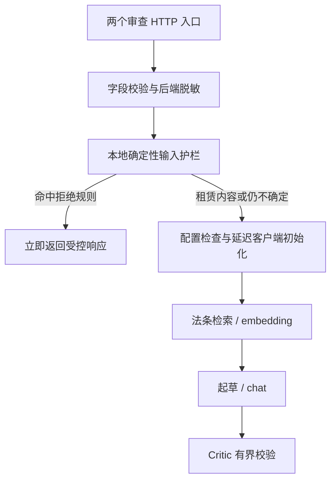

# 智租博弈：三大技术亮点与答辩证据

本文用于 Day 13/14 答辩，依据仓库中的实现、测试与已归档实测结果编写。系统围绕押金扣留、维修责任、提前退租，完成“合同风险审查 → 模拟谈判 → 协商清单”的闭环。运行步骤见[根目录 README](../README.md)，契约见 [Spec 00](specs/spec-00-architecture.md)、[Spec 02](specs/spec-02-risk-review.md)、[Spec 03](specs/spec-03-negotiation-scoring.md) 与 [Spec 04](specs/spec-04-negotiation-api-and-scenarios.md)。

答辩主线：把算分、状态提交、拒绝路径和引用身份交给可执行规则，把生成内容放在校验之后展示。当前 HTTP 谈判采用固定策略的离线模拟房东，不调用云模型；它验证的是可复现的协商流程与提交约束，不宣称能预测真实房东反应。

## 一张表说明系统差异

下表的对照对象是“仅靠 Prompt，让模型一次生成分析、分数和协议”的简单方案；不是对所有大模型应用的实测排名。

| 关键问题 | 仅靠自由生成的薄弱点 | 智租博弈的机制 | 可核验结果 |
| --- | --- | --- | --- |
| 谁决定分数 | 模型可能随措辞、轮次改变分数 | 纯 Python 规则从完整已确认条件重算；Critic 再算一次 | 同状态同分；单方要求、引用次数、内部重试不加分 |
| 何时认定达成协议 | 容易把请求、条件句或草稿当成承诺 | 候选条件与正式状态分开；确认、数值边界及 Critic 通过后才提交 | 失败保留上一轮条件、分数和轮次；同请求不重复提交 |
| 无关或无效输入如何退出 | 让模型先判断仍要检索或消耗 Token | 本地确定性护栏先于聊天客户端初始化、检索及云调用 | 命中拒绝规则的输入不进入 embedding/chat 路径；旧接口也受保护 |
| 引用是否可信 | 输出看似真实的法条编号不等于有证据 | 审查引用限定为本次检索集合；谈判引用限定为服务端可信集合，并核对回复一致性 | 阻止未检索或伪造编号作为已核验引用进入结果/确认状态 |
| 生成不合格怎么办 | 可能无限重试，或把坏草稿直接展示 | Critic 最多允许两次重写，第三次仍失败返回 `needs_review` | 重试上限固定；失败不提交；Trace 记录实际执行路径 |

## 亮点一：确定性算分与状态机隔离

### 分数是规则计算结果

规则由服务端配置起点、目标、权重、适用性和允许边界。模型或响应器可以提出候选条件，不能通过 HTTP 请求改写规则或最终分数。

```text
p_i = clip((confirmed_i - start_i) / (target_i - start_i), 0, 1)
score = round(100 × Σ(w_i × p_i) / Σw_i)
```

仅纳入存在确认值、适用、目标不等于起点且权重为有限正数的项目。`target == start` 排除该项；没有适用项返回 `None`（不可评分）。实现使用 `Fraction` 避免浮点累计误差，最后统一按 Python 半偶规则舍入；布尔值、NaN、无穷不能冒充金额。

三场景的演练参数与可复现结果如下，比例和金额是练习配置，不是法律责任或赔偿标准。

| 场景 | 计分项 | 起点 → 目标 | 前三轮固定确认值 | 对应模拟协商进展分 |
| --- | --- | --- | --- | --- |
| 押金扣留 | `deposit_refund` | 0 → 2000 元 | 1000 / 1500 / 2000 元 | 50 / 75 / 100 |
| 维修责任 | `repair_cost_share` | 0 → 100% | 50 / 75 / 100% | 50 / 75 / 100 |
| 提前退租 | `termination_fee` | 2000 → 0 元 | 1000 / 500 / 0 元 | 50 / 75 / 100 |

### 草稿不能修改正式协议

执行顺序为“辅导 → 房东回应与候选提取 → 规则试算 → Critic → 通过后提交”。`candidate_terms/candidate_score` 属于工作副本，`confirmed_terms/trial_score/round_count` 才是正式快照。虽然历史字段名为 `trial_score`，其公开值表示已经提交的当前分数，界面标为“模拟协商进展分”。

服务按 `session_id` 隔离，并为每个会话持有锁。图只接收深拷贝状态；通过后在锁内替换完整快照。失败重写或图异常不能改变正式条件、分数与轮次。HTTP 相同 `request_id`、相同脱敏消息返回缓存并标记 `replayed=true`；成功及质检失败响应均缓存，不再次执行图。单会话最多 5 轮，重启会清空单进程内存会话。

**现场例子：**已确认返还押金 1000 元，正式分为 50。下一候选提议 1500 元，但引用不属于可信证据集合，Critic 失败，即使候选试算为 75，正式条件仍为 1000 元、正式分仍为 50，轮次不推进。再次确认同一金额也不会累计成 100；只按当前状态重算。

代码入口：[scoring.py](../backend/app/services/scoring.py)、[negotiation_graph.py](../backend/app/services/negotiation_graph.py)、[negotiation_service.py](../backend/app/services/negotiation_service.py)。

可核验测试：

- [test_scoring.py](../tests/test_scoring.py)：`test_equal_target_and_start_is_inapplicable`、`test_same_state_same_score_and_inputs_are_not_mutated`、`test_aggregate_unrounded_progress_before_rounding`。
- [test_negotiation.py](../tests/test_negotiation.py)：`test_day07_failed_trial_preserves_previously_committed_score_and_state`、`test_day07_critic_recomputes_score_instead_of_trusting_trial`。
- [test_negotiation_api.py](../tests/test_negotiation_api.py)：`test_three_scene_http_commit_score_trace_and_five_round_limit`、`test_parallel_sessions_and_duplicate_requests_keep_trace_and_commits_isolated`。

## 亮点二：在云调用之前物理阻断明确无效输入

### 退出路径由本地代码决定

Day 11 把护栏放在详细审查入口的准备阶段，Day 12 将同一个 `classify_review_input` 接入旧 `analyze_contract` 服务方法，并使两个 HTTP 入口共用延迟初始化的服务依赖。请求先完成字段校验、后端脱敏，再运行护栏；被拒绝时不会初始化真实聊天客户端、创建向量库服务、检索或执行审查图。因此客户端直接访问旧接口也不能绕过这条拒绝路径。

这里的“物理阻断”指执行分支在进入下游组件前返回，不是模型收到输入后自行拒答。对于命中护栏的请求，embedding 与 chat 均为零调用，因而不产生本次审查的云端推理 Token；不能把此性质扩大为任意输入都能识别的安全保证。



两个接口共用拦截逻辑，保留各自响应契约：

| 入口 | 命中护栏时的响应 | 使用建议 |
| --- | --- | --- |
| `POST /api/review/analyze-detailed` | HTTP 200、`needs_review`；明确非租赁为 `OUT_OF_SCOPE`，纯载荷/无可读合同为 `INVALID_CONTRACT_TEXT`；空结果、零风险数、零重写，仅一条真实 `input_guard` Trace | 新前端和真实审查调用应使用此接口，并检查业务状态 |
| `POST /api/review/analyze` | HTTP 200、`mock`；保留原有 `success/mock`、非空演示结果及计数格式，不新增错误或 Trace 字段 | 兼容历史演示调用；Mock 内容不能当作真实审查结论 |

字段类型、长度、空白和 `top_k` 无效仍由请求校验返回 HTTP 422。详细版拒绝时 `total_risks=0` 表示没有通过审查的结果，不表示合同无风险。Spec 02 的 Day 11 历史条目只要求详细接口护栏；Day 12 的旧接口扩展保留其原响应兼容约束。

### 有意保留的边界

护栏只拒绝高置信的明确非租赁文本、纯程序载荷和无可读合同内容，不承担通用语义分类、浏览器净化或完整提示词注入检测。不能仅因出现“房东”“房屋”便认定租约，也不能仅因包含脚本便拒绝有真实租赁内容的合同。

**现场例子：**“家政服务合同：房东负责提供房屋钥匙，家政人员按次清洁。”按明确其他领域处理；纯 `<script>…</script>` 无合同内容时直接退出。“房东不退押金”混合脚本、附带真实租约的劳动材料以及模糊的租赁问题继续原流程。通过护栏仍须检索和 Critic，并不等于输入或结论已获全面安全认证。

服务被 Python 调用方直接构造时，默认构造器仍可能先初始化客户端；需要同样的初始化顺序时应显式传入 `defer_chat_init=True`。该生命周期区别不影响两个 HTTP 入口的前置阻断。

代码入口：[review_input_guard.py](../backend/app/services/review_input_guard.py)、[review.py](../backend/app/services/review.py)、[API 服务依赖](../backend/app/api/review.py)。边界与下游禁止调用断言见 [test_review_input_guard.py](../tests/test_review_input_guard.py)；其中测试会把真实客户端、向量库构造和图执行替换成“一旦调用即失败”的断言，同时封锁外部 HTTP。Day 12 将拒绝、422、脱敏测试扩展至两个端点，新增 `test_legacy_service_guard_also_blocks_injected_downstream_dependencies` 检查直接服务调用，`test_both_apis_continue_rental_uncertain_and_mixed_content` 检查真实租约、模糊文本及混合内容继续原流程。

已归档证据：[Day 11 固定 20 例报告](test-results/day11-eval-report.md)记录 20/20 公开 API 自动规则通过，其中 3 个范围外、2 个长异常样本在护栏退出，1 个短异常在字段校验退出；这 6 例观测到的同步 chat/embedding 请求均为 0。该历史云端观测针对详细接口；Day 12 旧接口覆盖由本轮离线回归验证，不能把 Day 11 报告当作旧接口的历史实测。观测范围限于报告列明的当前同步传输，不涵盖未来新增协议。

## 亮点三：用 Critic 约束谈判生成与证据，而非直接相信草稿

### 将“达成什么”变为可检查条件

谈判 Critic 是确定性校验节点。它检查结构与有限数值、服务端规则及底线、房东明确确认、回复与候选值一致、候选与回复的引用一致，以及引用是否属于服务提供的本次可信集合。确认提取使用完整场景模板；否定、条件句、转述、重复/冲突金额和跨场景模板不能成为正式数值条件。

例如租客说“我要求返还 2000 元”，不能自行产生确认条件；“如果检查通过，我确认返还押金 1000 元”也不符合明确确认模板。只有对应场景的完整确认文本，例如 `【模拟房东】我确认返还押金1000元。`，才能被提取为候选，并继续接受规则与 Critic 校验。当前固定离线策略的报价取决于成功轮次，不从租客金额或其声称的房东答复复制条件。

谈判引用必须属于 `LAW-703`～`LAW-734`、无重复、属于服务端 `available_evidence_ids` 且出现在房东回复中。默认 HTTP 演练的可信集合为空且不引用法条；浏览器不能把审查结果中的编号直接升级为谈判可信证据。审查侧另行检查 JSON、唯一条款标识、原句在脱敏合同中的精确定位，以及本次检索引用身份；非法或未检索引用会被过滤，导致 HIGH 没有引用时必须重写。

### 有界重写与可追溯失败

初次生成 `retry_count=0`；只有 Critic 失败且计数小于 2 才递增并重写，总生成最多 3 次。仍失败返回 `needs_review`。谈判失败不提交，并隐藏被拒绝回复和候选；审查详细版失败只返回受控原因，不返回坏草稿。两条图分别记录真实执行节点、受控反馈与实测耗时，完整响应后由前端标为“本次执行回放”；缓存响应另标回放，不伪装流式输出或隐藏思维。

**现场例子：**测试替身连续给出押金 3000 元，超出服务端 0～2000 元的演练边界。三次生成均失败后返回 `needs_review`、`retry_count=2`，正式会话仍没有确认金额、分数和已完成轮次；Trace 可核对三次 Critic 与两次重写。同编号重试复用该失败响应，换新编号才重新执行。

代码入口：[谈判 Critic 与重写路由](../backend/app/services/negotiation_graph.py)、[审查 Critic](../backend/app/services/graph.py)、[谈判 Trace](../backend/app/services/negotiation_trace.py)、[审查 Trace](../backend/app/services/review_trace.py)。

可核验测试：

- [test_negotiation.py](../tests/test_negotiation.py)：`test_day07_fabricated_terms_confirmation_or_evidence_cannot_commit`、`test_day07_invalid_duplicate_or_unretrieved_evidence_rejects_entire_round`。
- [test_negotiation_api.py](../tests/test_negotiation_api.py)：`test_scene_ambiguous_and_cross_scene_responses_never_confirm`、`test_real_retry_trace_and_failure_cache`、`test_http_failure_hides_rejected_draft_and_preserves_official_state`。
- [test_review_detailed.py](../tests/test_review_detailed.py)：`test_three_failures_exit_without_mock_findings`、`test_unexpected_graph_error_keeps_completed_trace`。

### 答辩中如何准确表达“零幻觉”

可以展示并由测试核对的承诺是：在当前严格模板与规则覆盖范围内，不把单方诉求变成正式条件，不相信候选分数，不把伪造/未核验引用作为可信引用提交，失败不污染正式协议。这些是结构、数值、状态与引用身份约束。

不能据此宣称任意自然语言谈判、法律解释或所有输出的语义幻觉率为零。当前 Critic 不能全面判断“某条法条是否实质支持某句法律结论”，真实模型谈判适配器也尚未完成语义验收。审查知识库仅覆盖《民法典》租赁合同第 703～734 条；范围不足须补依据。Day 11 的 20/20 是公开规则下的工程评估，预期标签待人工复核，并非法律准确率或完整安全认证。

建议答辩表述：“我们用前置护栏阻断明确无效输入，用规则保证同状态同分，用 Critic 与原子提交约束条件和证据。当前实现可证明这些边界，开放语义质量另行评估。”

## 复核与现场演示入口

从仓库根目录运行对应虚拟环境的离线测试；它们默认使用替身并阻断外部云调用，不应把离线通过解释为真实模型效果通过。

```powershell
.\.venv\Scripts\python.exe -m pytest -q tests/test_scoring.py tests/test_negotiation.py tests/test_negotiation_api.py tests/test_review_input_guard.py tests/test_review_detailed.py tests/test_review.py
```

三场景界面闭环、真实公开 HTTP Trace 与清单导出的历史证据见 [Day 10 实测报告](test-results/day10-round01.md)；云端审查的固定样本观测见 [Day 11 报告](test-results/day11-eval-report.md)。以上均为历史结果，本文不填写尚未执行的 Day 12 干净机器安装耗时、真实云模型谈判效果或新的法律准确率。
